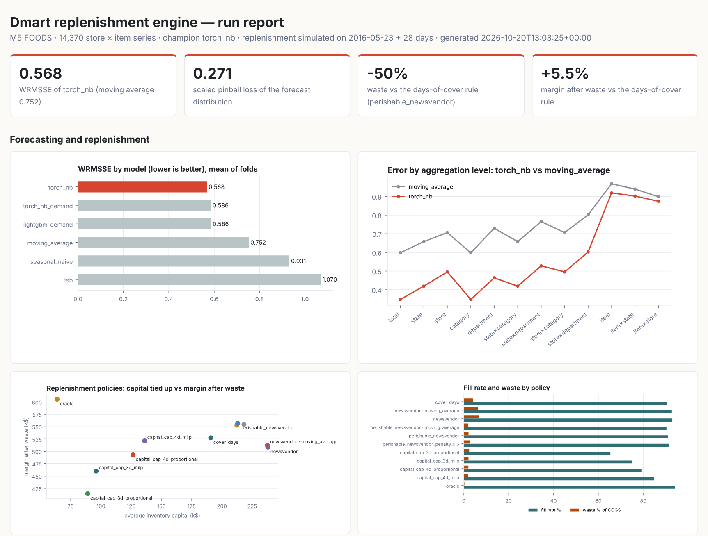
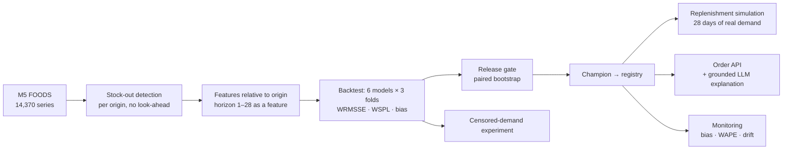

# dmart-replenishment-engine

Demand forecasting and replenishment for quick-commerce dark stores, from the forecast to the order
quantity:
- probabilistic forecasting models;
- a backtest and release gate every model must pass;
- ordering policies that know fresh food expires;
- an optimiser for when capital is short;
- an API that explains each order.

It is benchmarked on **real retail data**: the FOODS part of the M5 (Walmart) dataset, 14,370
store × item series over 1,969 days. Value is measured where it matters: in a day-by-day simulation
of ordering against the real demand of a month the models never saw.



```bash
pip install -e ".[torch,dev]"            # Python 3.11+
dre download                             # M5 data (~50 MB zip)
dre run --out out                        # 10 stores, all models: ~70 min on 2 CPU cores
dre run --fast --stores CA_1 --out out   # one store, lighter models: ~3 min
dre serve --registry out/registry        # order API on :8080
pytest -q                                # 33 tests
```

A complete sample of the outputs (model card, dashboard, backtest, policies, monitoring) is in
[`docs/sample-run/`](docs/sample-run/).

## What one run does



| Part | Where | What it does |
|---|---|---|
| Data | `data/m5.py`, `data/stockouts.py` | Sales, prices, events and SNAP days as dense series × day matrices. Zero runs that are improbable given an item's recent selling rate are flagged as stock-outs, from data up to each forecast origin only. Gaps over 14 days count as delisting, not lost demand. |
| Features | `features.py` | One row per series, origin and horizon. Inputs: recent levels (1–364 days), same-weekday means, last year, planned price changes, events, SNAP, stock-out share and launch age. Built from cumulative sums at about 1.6M rows a second. A test overwrites the future and checks that no feature changes. |
| Models | `models/` | Baselines: seasonal naive, a 28-day moving average with a weekday profile, and TSB for intermittent demand. Global models: LightGBM (Tweedie) and a PyTorch network with entity embeddings and a negative-binomial output. All return a distribution through one `Forecaster` contract. |
| Evaluation | `evaluation/` | Rolling-origin backtest with retraining at every origin. Uncertainty is calibrated on the previous fold's out-of-sample errors, net of that fold's bias. Metrics: M5 WRMSSE over 12 hierarchy levels (it reproduces the published seasonal-naive score of 0.847), WSPL, coverage, bias and WAPE. |
| Release gate | `evaluation/gate.py` | A challenger replaces the champion only if it is better on average and significantly so (95% paired bootstrap over series), is no worse on uncertainty or bias, and wins most folds. |
| Replenishment | `replenishment/` | Daily simulation with first-expiry-first-out (FEFO) issuing, expiry by shelf life, supplier delivery days, case packs and shelf capacity. Policies: a days-of-cover heuristic, the textbook newsvendor, a perishable-aware newsvendor, a capital-capped multiple-choice knapsack (MILP, HiGHS) vs proportional cuts, and an oracle. |
| Serving | `service/api.py`, `explain/llm.py` | FastAPI serves forecasts with quantiles, and order advice from current stock with the drivers behind each number. An optional LLM rephrases the drivers; every number it writes must match a driver, or the template is used. |
| Ops | `registry.py`, `monitoring/`, `infra/gcp/`, CI | File registry: artifact, metrics, gate decision and hashes. Monitoring: data checks, bias and WAPE alerts by store and department, PSI drift. GCP Terraform: Cloud Run job for the nightly batch, Cloud Run service for the API, GCS, Scheduler, Secret Manager, least-privilege service accounts, EU region. |

The standards squads follow, with a review checklist, are in [docs/ML_STANDARDS.md](docs/ML_STANDARDS.md).

## Results

### Forecasting: 3 folds of 28 days, the last one the M5 evaluation month (23 May – 19 Jun 2016)

| Model | WRMSSE | WSPL | Bias | WAPE (days 1–7) | 95% interval coverage | Gate |
|---|---|---|---|---|---|---|
| torch_nb | **0.568** | 0.271 | +0.8% | 65.0% | 96.8% | champion |
| torch_nb_demand | 0.586 | 0.271 | +2.1% | 65.2% | 96.8% | rejected |
| lightgbm_demand | 0.586 | 0.273 | -1.4% | 64.8% | 96.6% | rejected |
| moving_average | 0.752 | 0.276 | -1.5% | 67.4% | 95.5% | baseline champion |
| seasonal_naive | 0.931 | 0.395 | -4.1% | 81.4% | 79.4% | rejected |
| tsb | 1.070 | 0.289 | +0.0% | 68.6% | 96.0% | rejected |

- **Champion: the PyTorch negative-binomial network.**
  - WRMSSE 0.568 vs 0.752 for the moving average (24% lower).
  - It won 3 of 3 folds. The dollar-weighted per-series improvement has a 95% CI of [-0.029, -0.021].
- **LightGBM was close, but the gate rejected it.** It lost 2 of 3 folds and is not significantly different from the champion.
  - It is unbiased in-sample but under-forecast one month by about 6%. The network extrapolates that level shift better.
  - Giving LightGBM the same log-level offset did not close the gap.
- **Masking stock-outs in training was rejected too.** Only 1.1% of days are flagged in the real data, and masking made no measurable difference (weighted RMSSE difference +0.0002, 95% CI [-0.0013, 0.0016]).

### Censored demand: does stock-out correction matter when stock-outs are common?

Stock-out episodes of 3–7 days were planted in the history of 909 items in store CA_3.
They removed 8.8% of those items' sales; the test month was left untouched.

| Training history | Forecast bias on the true test month |
|---|---|
| clean | -5.9% |
| damaged, stock-out days kept | -13.1% |
| damaged, stock-out days masked | -6.0% |

- **Masking removes the bias the stock-outs introduced.** That holds even though the detector flags only 49% of the planted episodes: the ones it misses are short gaps in slow items, which matter least.
- **The lever is kept for assortments with frequent stock-outs.** On M5, the gate says it is not needed.

### Replenishment: 28 days of real demand, 10 stores, 14,370 items

| Policy | Fill rate | Waste / COGS | Avg capital | Margin after waste | Fresh: fill · waste |
|---|---|---|---|---|---|
| cover_days | 90.7% | 4.2% | 190,772 | 527,559 | 95.2% · 25.0% |
| newsvendor · moving_average forecast | 92.7% | 6.3% | 237,583 | 512,463 | 96.5% · 32.6% |
| newsvendor | 93.0% | 6.7% | 237,909 | 508,667 | 97.1% · 35.3% |
| perishable_newsvendor · moving_average forecast | 90.3% | 2.0% | 212,366 | 553,087 | 82.8% · 9.7% |
| perishable_newsvendor | 91.0% | 2.1% | 213,122 | 556,824 | 84.9% · 10.1% |
| perishable_newsvendor_penalty_0.6 | 91.6% | 2.6% | 218,232 | 554,486 | 88.6% · 12.7% |
| capital_cap_3d_proportional | 65.4% | 2.4% | 89,088 | 414,397 | 79.7% · 9.3% |
| capital_cap_3d_milp | 74.9% | 2.1% | 96,043 | 459,862 | 79.5% · 9.2% |
| capital_cap_4d_proportional | 79.2% | 2.1% | 126,640 | 493,228 | 80.9% · 9.2% |
| capital_cap_4d_milp | 84.7% | 2.0% | 136,123 | 521,446 | 81.7% · 9.3% |
| oracle | 94.1% | 0.3% | 63,872 | 605,567 | 99.0% · 1.5% |

- **Perishable-aware ordering beats the days-of-cover rule.**
  - Margin after waste is 5.5% higher and waste 50% lower, at a similar fill rate.
  - It values each unit over its shelf life. A unit that does not sell before the next delivery is sold first afterwards (FEFO) and saves a purchase, unless it expires first. Stock is held while that expected value is positive.
- **The textbook newsvendor ignores expiry, and fresh margin collapses.** Its fresh waste reaches 35% of cost of goods, and fresh margin is 14.0k. The days-of-cover rule earns 32.5k on fresh, the perishable-aware policy 52.1k.
- **Fresh availability is a business decision, and the run prices it.**
  - With a goodwill penalty of 20% of price for an empty shelf, fresh fill rate is 85%.
  - At 60%, it rises to 89%, with total margin at 554,486.
- **When capital is capped, the MILP allocates it better than cutting every order.** It earns 11.0% more margin at a 3-day cap and 5.7% more at a 4-day cap.
- **Most of the gain comes from the policy, not the forecast.**
  - With the same perishable policy, the champion forecast vs the moving average gives margin +0.7%, waste +8%, fill rate 90.3% → 91.0%.
  - The forecast improves most at store level (RMSSE 0.50 vs 0.71). Orders are placed per item, where it improves least (0.87 vs 0.90).
  - The oracle earns 605,567 with a third of the capital, so the next gain is a model trained for the item-level decision. The obvious candidate: the pinball loss at each order's critical ratio.

### Monitoring at go-live

- **5 alerts on the evaluation month:** CA_3 bias +6.2%, CA_4 WAPE 84.4%, WI_2 bias +6.7%, FOODS_1 bias +5.2%, FOODS_2 bias +7.6%.
- **These are local problems.** The champion is more than 5% biased in a store or department, or 20% worse than in the backtest, although its total bias is small. A squad would check supply or feed issues before changing the model.
- **No input drift.** Input drift (PSI) is green on all monitored features.

## API

```bash
curl localhost:8080/v1/forecast/CA_1/FOODS_3_090
curl -X POST localhost:8080/v1/orders -H 'content-type: application/json' -d '{
  "store_id": "CA_1", "date": "2016-05-22",
  "stock": [{"item_id": "FOODS_1_001", "units": 6, "remaining_life_days": 2}]
}'
```

Each order line carries its drivers and an explanation, for example:

> Order 144 units (6 × 24) of FOODS_3_120 for CA_1. Demand until the next delivery (3 days) is forecast at 130.2 units; we stock to 189 units to meet 98% of demand. 65 units are on hand.

With `ANTHROPIC_API_KEY` set, an LLM may phrase the explanation more naturally. If any number in its text is not a driver, the template is returned instead and the rejection reason is recorded.

## Repository layout

```
config/dre.yaml       folds, models, gate rules and every economic assumption — reviewed like code
src/dre/
  data/               M5 loader, synthetic panel for tests, stock-out detector
  features.py         origin-relative feature rows
  models/             Forecaster contract, baselines, LightGBM, PyTorch NB
  evaluation/         metrics (WRMSSE, WSPL), backtest, release gate, censoring experiment
  replenishment/      economics, simulation and policies, MILP, order advisor
  explain/            grounded LLM explanations
  monitoring/ registry.py service/ reporting/ pipeline.py cli.py
infra/gcp/            Terraform: Cloud Run job + service, GCS, Scheduler, Secret Manager
docs/                 ML standards and review checklist, sample run outputs
```

[CI](.github/workflows/ci.yml) runs on every push:
- lint and the 33 tests;
- the full pipeline on real M5 data for one store, with a summary posted to the job page;
- a Docker build that serves that run's registry and calls the order API;
- Terraform `fmt` and `validate`.

## Assumptions and limitations

- **M5 is Walmart supermarket data, not dark-store data.** Assortment, basket size and delivery promise differ. The method transfers; the numbers are evidence for the method, not a prediction of results elsewhere.
- **The economics are assumptions.** M5 has no costs, shelf lives, pack sizes or delivery schedules. They are documented in `config/dre.yaml` and are the same for every policy. M5's departments are anonymised and stand in for temperature zones.
- **The simulation replays recorded sales, which are censored demand.** A policy that holds more stock cannot sell more than history did. Fill-rate gains are therefore lower bounds; waste figures are not.
- **Models are trained monthly and forecasts refreshed daily.** That is the usual production pattern, and it is the same for every model-based policy.
- **The run fits 2 CPU cores and 7 GB of RAM.** Training uses half the series per origin, a year of origins and 2 network epochs. More data, or an ensemble, would likely help; the gate would decide.
- **Deployment is validated but not live.** The Terraform passes `validate` and the container is built and smoke-tested in CI. Neither has been deployed to a live GCP project.

MIT licence.
